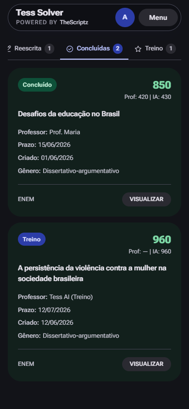
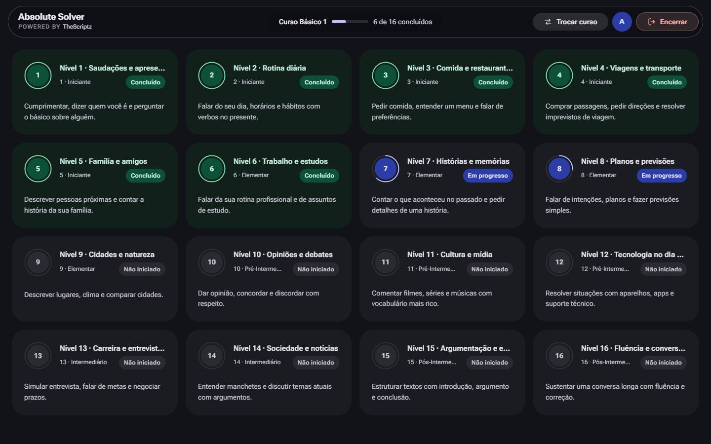
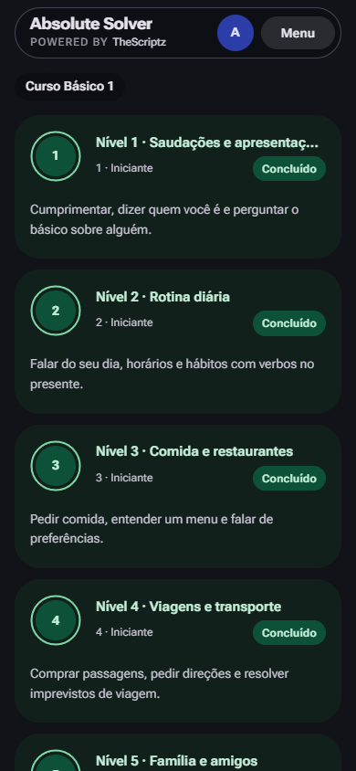
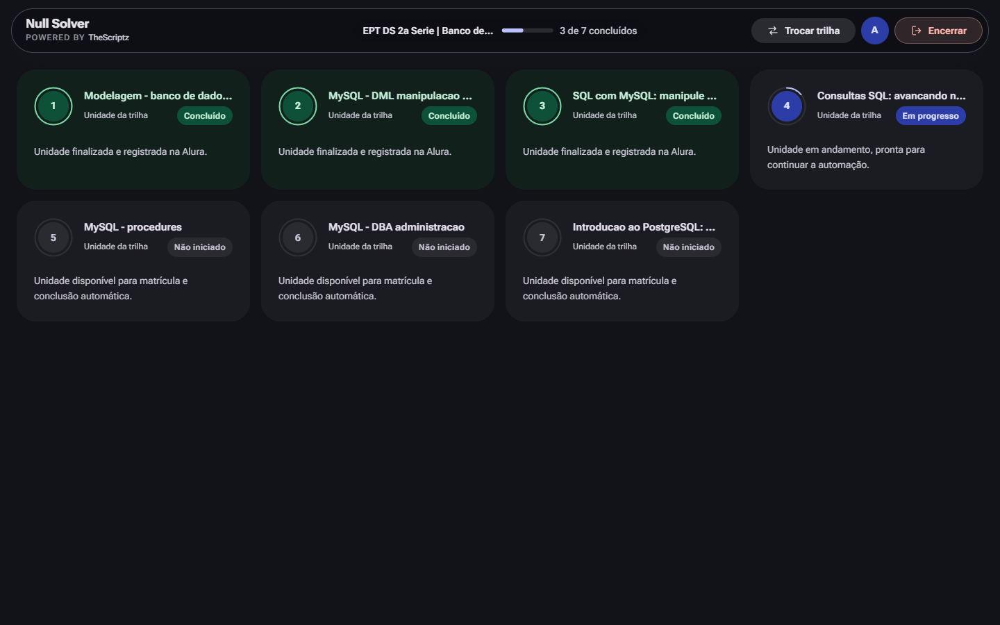
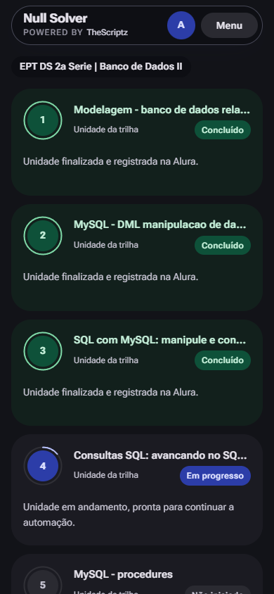

# TheScriptz — visão geral

**O colégio inteiro resolvido em segundos.** Um bookmark e painéis dedicados para automatizar as plataformas educacionais do Paraná, direto do navegador.

[Site](https://thescriptz.fun) · [Planos](https://thescriptz.fun/planos) · [Instalar](https://thescriptz.fun/instalar) · [Painéis](https://thescriptz.fun/paineis)

## O que é o TheScriptz

O TheScriptz é uma ferramenta brasileira de automação de estudos para alunos da rede estadual do Paraná. Um único bookmark resolve atividades no Wayground (Quizizz), Khan Academy, Leia Paraná, Redação Paraná, Inglês Paraná (EF Efekta) e Enem Paraná. A Alura Start tem um painel dedicado e está temporariamente em manutenção.

O bookmark reconhece o login escolar `@escola.pr.gov.br`, valida a licença na conta do aluno e abre um menu flutuante na própria plataforma. Para Redação, Leia, Inglês e Alura, ele abre um painel dedicado que roda na nossa infraestrutura — a automação continua mesmo se você fechar a aba.

## Plataformas

| Plataforma | Solução | Landing | Repositório |
|---|---|---|---|
| Wayground (Quizizz) | Script com IA + banco de respostas do Desafio Paraná | [wayground-hack](https://thescriptz.fun/wayground-hack) | [repo](https://github.com/thescriptz/Wayground-Hack) |
| Khan Academy | Banco com ~4.900 exercícios + IA de fallback | [khan-academy-hack](https://thescriptz.fun/khan-academy-hack) | [repo](https://github.com/thescriptz/Khan-Academy-Hack) |
| Leia Paraná | Painel Codex Solver | [leia-parana-hack](https://thescriptz.fun/leia-parana-hack) | [repo](https://github.com/thescriptz/Leia-Parana-Hack) |
| Redação Paraná | Painel Tess Solver | [redacao-parana-hack](https://thescriptz.fun/redacao-parana-hack) | [repo](https://github.com/thescriptz/Redacao-Parana-Hack) |
| Inglês Paraná (EF Efekta) | Painel Absolute Solver | [ingles-parana-hack](https://thescriptz.fun/ingles-parana-hack) | [repo](https://github.com/thescriptz/Ingles-Parana-Hack) |
| Enem Paraná | Bookmark sem IA | [enem-parana-hack](https://thescriptz.fun/enem-parana-hack) | [repo](https://github.com/thescriptz/enem-parana-hack) |
| Alura Start | Painel Null Solver (em manutenção) | [alura-hack](https://thescriptz.fun/alura-hack) | [repo](https://github.com/thescriptz/Alura-Hack) |

## Prints dos painéis

### Redação Paraná — Tess Solver

Versão mobile

### Leia Paraná — Codex Solver

Versão mobile

### Inglês Paraná — Absolute Solver

Versão mobile

### Alura — Null Solver

Versão mobile

## Planos e preços

| Plano | Preço | Período |
|---|---|---|
| Semanal | R$ 5,97 | 7 dias |
| Mensal | R$ 14,97 | 30 dias |
| Trimestral | R$ 34,97 | 90 dias |
| Anual | R$ 119,97 | 365 dias |

Todos os planos incluem o bookmark e os painéis disponíveis. Pagamento via Pix; renovar antes do vencimento soma o novo período ao tempo restante.

## Links

- **Site oficial:** [thescriptz.fun](https://thescriptz.fun)
- **Planos:** [thescriptz.fun/planos](https://thescriptz.fun/planos)
- **Instalar:** [thescriptz.fun/instalar](https://thescriptz.fun/instalar)
- **Painéis:** [thescriptz.fun/paineis](https://thescriptz.fun/paineis)
- **Perfil no GitHub:** [github.com/thescriptz](https://github.com/thescriptz)
- **Suporte:** [WhatsApp](https://wa.me/5562981046894)

## Aviso

O código-fonte do TheScriptz é privado. Este repositório contém apenas informações públicas do produto, com imagens do próprio site.

O TheScriptz é independente e não possui vínculo com o Governo do Paraná, a Secretaria de Estado da Educação do Paraná, a Wayground/Quizizz, a Khan Academy, a Alura, a EF Education First ou os organizadores do Enem.
